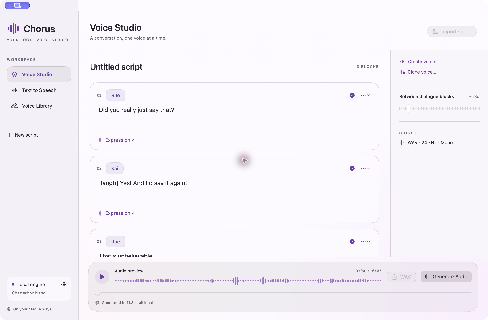
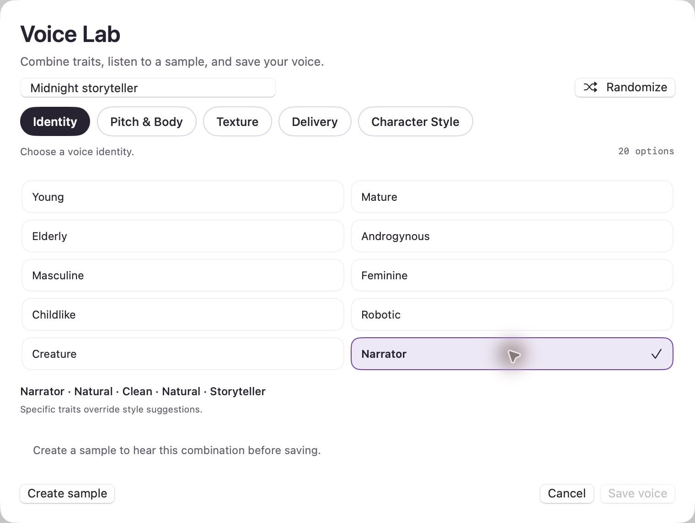

<div align="center">

# Chorus

### Your local voice studio.

Create conversations, turn text into speech, and build voices — on your Mac.

[](https://github.com/apoorv-agnihotri/Chorus/releases/latest)
[](https://github.com/apoorv-agnihotri/Chorus/releases/latest)
[](LICENSE)

**No account. No credits. Local generation after setup.**

</div>



## A conversation, one voice at a time

Write a script, choose a voice directly on each dialogue block, and hear the result.
Switch between a conversation and a single narration without leaving your studio.

| In your studio | What you can do |
| :--- | :--- |
| **Voice Studio** | Mix voices across dialogue blocks, import tagged scripts, and adjust pauses. |
| **Text to Speech** | Turn a passage into narration with a bundled, created, or cloned voice. |
| **Voice Lab** | Combine identity, pitch, texture, delivery, and character style. Preview before saving. |
| **Voice Library** | Start with Rue, Kai, Atlas, Zia, and Indie. Customize and delete your saved voices. |
| **Voice cloning** | Create a reusable voice from a recording you have permission to use. |
| **WAV export** | Preview locally and export 24 kHz mono audio. |

## Make a voice your own

Choose from 20 options in each of five trait categories. Listen to a sample, try another
combination, and save the voice to your library. The entire trait tile is clickable.
Voice traits are creative controls; preview the result to decide whether it fits your story.



## Download and get started

1. Download **Chorus-v0.7.0-macOS-arm64.zip** from the [latest release](https://github.com/apoorv-agnihotri/Chorus/releases/latest).
2. Unzip it and move **Chorus.app** to **Applications**.
3. Open Chorus and choose **Download Nano & Kokoro** in the welcome screen.
4. Keep an internet connection during this one-time setup. Allow roughly **2 GB** of free space.
5. Choose a voice, write your text, and click **Generate Audio**.

**Requires an Apple Silicon Mac (M1 or newer) running macOS 15 or later.**
Intel Macs are not supported by this release.

The download contains the app, bundled voice profiles, and its native runtime. Large
speech models are downloaded during setup, rather than included in the ZIP. The first
sample can take longer while Core ML compiles its models. After setup, cached models
let you create offline.

> **Opening the app:** this release is ad hoc signed, not Apple-notarized. macOS may
> block its first launch. For an app you trust, use the **Open Anyway** option in
> **System Settings → Privacy & Security** after attempting to open it. This does
> not require disabling Gatekeeper. See [Apple's guidance](https://support.apple.com/en-us/102445).

### The engines

| Engine | Included in first-run setup | Purpose |
| :--- | :---: | :--- |
| **Chatterbox Nano** | Yes | Recommended default for expressive speech and conversations. |
| **Kokoro** | Yes | English presets and references for Voice Lab. |
| **Chatterbox Turbo** | Optional | A larger alternative, available in **Local engine**. |

Chorus uses native Swift and Core ML for Kokoro and Chatterbox. There is no Python
runtime to install. Models load when needed and are released after two idle minutes.

## Bring your script

Use **Import script** with speaker tags matching a voice name:

```text
[rue]
Did you really just say that?

[kai]
[laugh] Yes! And I'd say it again!

[rue]
That's unbelievable.
```

Choose or change the voice on any imported block. Chatterbox supports reactions such
as `[laugh]`, `[sigh]`, and `[gasp]`; use the **Expression** menu to insert supported
tags. The workspace saves automatically.

## Local by design

- Your text and recordings are processed on your Mac for generation and cloning.
- Model downloads use Hugging Face and GitHub; there are no analytics or cloud generation services.
- Quiet generated speech receives conservative leveling; adequately loud speech passes through unchanged.
- The app retries a specific intermittent Core ML loading error on CPU automatically.
- Voice files and models live in `~/Library/Application Support/Chorus/`.

## Build from source

Requires Apple Silicon, Swift 6.4 or later, and Xcode 27 or a compatible Command Line
Tools installation with a macOS 26-or-newer SDK.

```sh
git clone https://github.com/apoorv-agnihotri/Chorus.git
cd Chorus
bash scripts/build-app.sh
open dist/Chorus.app
```

Run the regression suite with:

```sh
bash scripts/test.sh
```

The build bundles the native MLX shader runtime and third-party licenses. Build
caches, generated audio, model downloads, and experimental planner files are kept
out of this repository.

For architecture, limitations, and inference commands, see the
[developer guide](docs/DEVELOPMENT.md), [validation notes](docs/VALIDATION.md),
[model lifecycle](docs/MEMORY.md), and [Kokoro integration](docs/KOKORO.md).

## License and credits

Chorus is [MIT licensed](LICENSE). Third-party code, models, and voice assets retain
their own licenses and attribution. See [third-party notices](THIRD_PARTY_NOTICES.md)
and the bundled license files. Chatterbox speech keeps the upstream Perth watermark.

Built with SwiftUI, Chatterbox Core ML, Kokoro Core ML, and Apple's MLX runtime.
